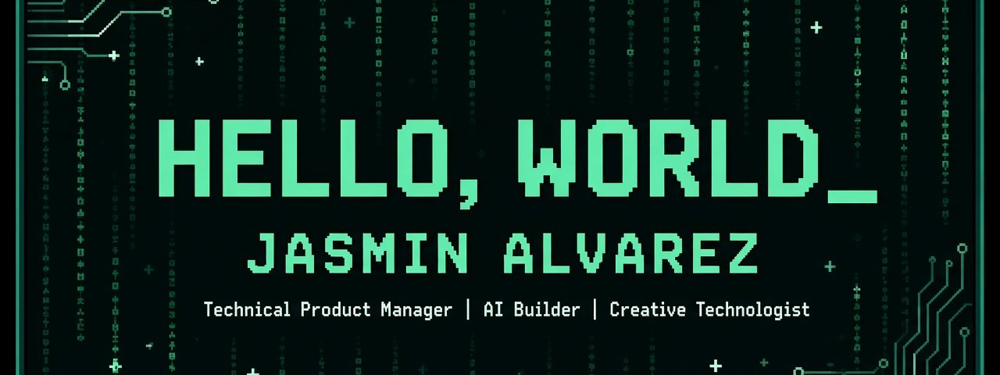
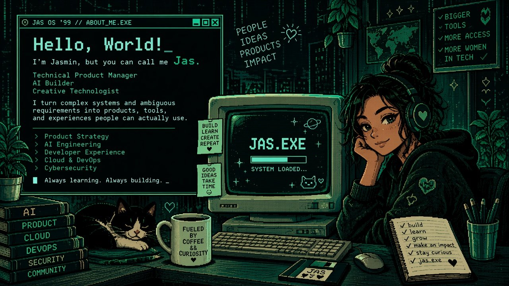
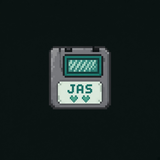

<!-- JAS OS '99 // ABOUT_ME.EXE — GitHub profile README -->

<div align="center">

  

  <br/>

  

  <br/><br/>

  
  &nbsp;&nbsp;
  

  <h3>
    <code>JAS OS '99</code> &nbsp;//&nbsp; <code>ABOUT_ME.EXE</code> &nbsp;//&nbsp; <code>JAS.MODE</code>
  </h3>

  <p>
    <strong>Jasmin Alvarez</strong> · you can call me <strong>Jas</strong> 👾<br/>
    Technical Product Manager &nbsp;|&nbsp; AI Builder &nbsp;|&nbsp; Creative Technologist
  </p>

  <p>
    
    
    
  </p>

  

</div>

---

## `C:\USERS\JAS\WHOAMI`

```text
JAS OS '99  >  whoami
────────────────────────────────────────
user ...... Jasmin Alvarez (Jas)
role ...... Technical Product Manager
also ...... AI Builder · Creative Technologist
mode ...... JAS.MODE — always learning, always building
────────────────────────────────────────
```

Hi! I'm **Jasmin Alvarez**, but you can call me **Jas**. 👾

I'm a technical product manager, AI builder, and creative technologist who enjoys turning complicated ideas into products people can actually use.

Previously, I worked as a **Senior Product Manager** and **Technical Marketing Engineer** at **Hewlett Packard Enterprise**.

I'm also a **Resilient Coders** alumna and **AI Product Engineer**.

**My interests include:**

- AI engineering and AI products
- Developer tools and developer experience
- Technical product management
- Cloud and DevOps
- Cybersecurity
- Building creative technical projects

**My philosophy:**

> *"I turn messy systems and ambiguous requirements into tools and workflows people can actually use."*


---

## `C:\USERS\JAS\EXPERIENCE.LOG`

```text
JAS OS '99  >  type EXPERIENCE.LOG
```

### Hewlett Packard Enterprise
**Senior Product Manager & Technical Marketing Engineer**

Shipped developer-facing tools and workflows for field and API users — with measurable speedups:

| Metric | Before | After | Impact |
| :---: | :---: | :---: | :--- |
| API workflow | **45 days** | **45 seconds** | Order-of-magnitude faster path to value |
| NinjaSTARS workflow | **60 min** | **12 min** | 5× faster operator loop |
| Field tooling | — | **2,000+** users | Tools supporting a large field organization |

<details>
<summary><code>view mission notes_</code></summary>

<br/>

- Bridged product, engineering, and technical marketing to make complex systems usable
- Focused on developer experience, workflow automation, and clear product narratives
- Built for real operators — not slideware

</details>


---

## `C:\USERS\JAS\PROJECTS`

```text
JAS OS '99  >  dir PROJECTS /w
```

###  [KrewsAgent](https://github.com/devchicajas/KrewsAgent)

AI ops crew for founders who need help but can't hire yet. Four crews (**Ops**, **Growth**, **Support**, **Finance**) propose actions from Gmail / GitHub — **you approve before anything executes**.

`Next.js` · `TypeScript` · `TARS` · `Supabase` · `Vercel`

[](https://github.com/devchicajas/KrewsAgent)
[](https://krews-agent.vercel.app)

###  [LLM Model Evaluation System](https://github.com/devchicajas/LLM-model-evaluation-system-for-Claude-Sonnet-4-migration)

Repeatable eval harness for **Claude Sonnet 4 migration**: runs the same realistic prompts across candidate models, scores them with an LLM judge + rule checks, stores results in PostgreSQL, and produces a ranked recommendation for engineers and product stakeholders.

`TypeScript` · `LLM-as-judge` · `PostgreSQL` · `Eval dashboard`

[](https://github.com/devchicajas/LLM-model-evaluation-system-for-Claude-Sonnet-4-migration)


---

## `C:\USERS\JAS\TECH_STACK`

```text
JAS OS '99  >  load TECH_STACK.dll
```

### Product & Developer Experience


### AI & Engineering


### Cloud & DevOps


### Cybersecurity


---

## `C:\USERS\JAS\CONNECT`

```text
JAS OS '99  >  ping NETWORK
```

<div align="center">

  <p>
    
    Let's build something people can actually use.
    
  </p>

  <p>
    <a href="https://github.com/devchicajas">
      
    </a>
    <a href="https://github.com/devchicajas/KrewsAgent">
      
    </a>
  </p>

  <p><code>Always learning. Always building. _</code></p>

  <br/>

  

  <p>
    <sub>
      <code>JAS OS '99</code> · boot complete · running <code>JAS.MODE</code> 💚
    </sub>
  </p>

</div>
