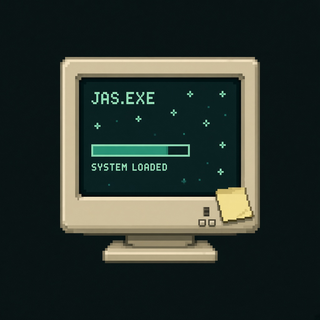

<!-- JAS OS '99 // ABOUT_ME.EXE — GitHub profile README (V2) -->

<div align="center">

  

  <br/>

  <p><strong><code>JAS OS '99</code></strong> // <strong><code>JAS.EXE</code></strong> // <strong><code>ABOUT_ME.EXE</code></strong></p>

  <h2>Jasmin</h2>

  <p>Technical Product Manager · AI Builder · Creative Technologist</p>

  <p>
    <a href="https://jasminalvarez.com"></a>
    <a href="https://github.com/devchicajas"></a>
    
  </p>

</div>

---

## `C:\USERS\JAS\WHOAMI`

```text
JAS OS '99  >  whoami
────────────────────────────────────────
user ...... Jasmin (Jas)
role ...... Technical Product Manager
also ...... AI Builder · Creative Technologist
mode ...... JAS.MODE — always learning, always building
────────────────────────────────────────
```
---

## `C:\USERS\JAS\PROJECTS`

###  [KrewsAgent](https://github.com/devchicajas/KrewsAgent)
Approval-gated AI ops crews (Ops, Growth, Support, Finance) that draft actions from Gmail and GitHub — execute only after you say yes.

`TypeScript` · `Next.js` · `AI agents` · `Supabase`  
[Repo](https://github.com/devchicajas/KrewsAgent) · [Live demo](https://krews-agent.vercel.app)

###  [LLM Model Evaluation System](https://github.com/devchicajas/LLM-model-evaluation-system-for-Claude-Sonnet-4-migration)
Eval harness for **Claude Sonnet 4 migration**: same prompts across candidate models, LLM judge + rule checks, PostgreSQL results, and a ranked recommendation for product and engineering.

`TypeScript` · `LLM-as-judge` · `PostgreSQL`  
[Repo](https://github.com/devchicajas/LLM-model-evaluation-system-for-Claude-Sonnet-4-migration)

---

## `C:\USERS\JAS\TECH_STACK`

**Product & Developer Experience**  


**AI & Engineering**  


**Cloud & DevOps**  


**Cybersecurity**  


---

## `C:\USERS\JAS\CONNECT`

<div align="center">

  <p>Let's build something people can actually use.</p>

  <p>
    <a href="https://jasminalvarez.com"></a>
    <a href="https://github.com/devchicajas"></a>
  </p>

  <p>
    
  </p>

  <p><code>Always learning. Always building. _</code></p>
  <p><sub><code>JAS OS '99</code> · running <code>JAS.MODE</code> 💚</sub></p>

</div>
